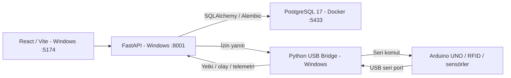

# FitGate

FitGate, spor salonları için üyelik, ödeme, RFID giriş-çıkış, personel mesaisi,
ders/randevu, stok ve işletme raporlarını yöneten bir Windows uygulamasıdır.
Admin ve çalışanlar aynı giriş ekranını kullanır; ekranlar ve API işlemleri rol
ve şube yetkilerine göre ayrılır.

> Bu depo yerel geliştirme/turnike prototipidir. Üretim kurulumu veya güvenlik
> sertifikalı bir turnike sistemi değildir. Gerçek kullanıcı verileri ve parolalar
> kaynak kodla birlikte dağıtılmaz.

## Özellikler

- Üye kaydı, paket satışı/yenileme/dondurma, seans ve giriş koşulları.
- Borç, taksit, tahsilat, gerekçeli iade, stok/satış ve kasa takibi.
- Personel vardiyası, izin, ücretli/ücretsiz mola ve mesai raporları.
- Ders rezervasyonu, katılım, bildirimler, raporlar ve denetim günlüğü.
- RFID veya personel tarafından açıkça doğrulanan manuel giriş-çıkış.
- Arduino olmadan manuel üye ve personel işlemleri; yetkiler ayrıca tanımlanır.

## Teknolojiler ve Mimari

React + Vite, Python + FastAPI, SQLAlchemy, Alembic, PostgreSQL 17,
Docker Desktop, Arduino UNO/RC522 RFID ve Python USB Bridge kullanılır.



**Yalnızca PostgreSQL Docker'da çalışır.** React, FastAPI ve Bridge Windows
süreçleridir. Mevcut sistem Docker Compose kullanmaz; frontend/backend'i
Docker'a taşımak günlük çalışma için gerekli değildir.

## Gereksinimler

- Windows ve Windows PowerShell 5.1; Git; Docker Desktop'ın Linux konteyner motoru.
- Python **3.10+**: mevcut FastAPI paketinin minimum gereksinimi 3.10'dur;
  bu proje Python **3.10.11** ile doğrulandı.
- Node.js: kilitli Vite sürümü `^20.19.0 || >=22.12.0` ister;
  mevcut ortam **20.19.6** ile doğrulandı. `npm ci` kullanın.
- Arduino ve USB sürücüsü isteğe bağlıdır. Port bu bilgisayarda COM6;
  farklı bir bilgisayarda farklı olabilir.

## İlk Kurulum

PRIVATE depoya erişimi olan hesapla:

```powershell
git clone https://github.com/Erdemgmssy/FitGate.git
cd FitGate
cd backend
python -m venv .venv-fastapi
.\.venv-fastapi\Scripts\python.exe -m pip install -r requirements-fastapi.lock.txt
```

Docker Desktop hazırken, **yalnızca yeni ve verisiz bir kurulumda**:

```powershell
.\.venv-fastapi\Scripts\python.exe tools/local_postgres.py
.\.venv-fastapi\Scripts\python.exe -m alembic upgrade head
.\.venv-fastapi\Scripts\python.exe tools/create_admin.py
cd ..\frontend
npm ci
cd ..
```

İlk kurulum aracı güçlü rastgele değerlerle yerel `.env.fastapi` ve Docker
ayarını oluşturur; parolaları yazdırmaz. Mevcut ayar, konteyner veya volume
varsa durur: eski kurulumu sıfırlamak veya parolasını değiştirmek için kullanılmaz.
`.env.fastapi.example` yalnızca güvenli alan örneklerini gösterir.
Alternatif yapılandırma, USB kaydı ve yedekleme için [Windows Kurulumu](docs/KURULUM.md).

## Günlük Çalıştırma

1. Docker Desktop'ı açın.
2. `FitGate-Baslat.bat` dosyasına çift tıklayın.
3. [FitGate](http://127.0.0.1:5174/) açılınca kendi hesabınızla giriş yapın.

Başlatıcı Docker/SQL hazır olmasını sınırlı süre bekler, mevcut servisleri yeniden
kullanır ve ayarı varsa Bridge'i başlatır. Arduino yokken web uygulaması çalışır.
Varsayılan admin parolası yoktur. Otomatik demo veri oluşturma/sıfırlama yapılmaz.

`FitGate-Durdur.bat` yalnızca başlatıcının yönettiği uygulama süreçlerini kapatır.
Başka Python/Node uygulamalarına, Docker'a ve PostgreSQL'e dokunmaz.
Elle açılan sunucuları kendi terminalinde `Ctrl+C` ile durdurun.

Geliştirici için üç ayrı Windows PowerShell terminalinde:

```powershell
.\start-backend.ps1
.\start-frontend.ps1
.\start-bridge.ps1  # Yalnızca yerel cihaz ayarı varsa
```

API: http://127.0.0.1:8001/docs · Sağlık: http://127.0.0.1:8001/api/v1/health/

## Veritabanı ve Güvenlik

`fitgate-postgres` konteyneri `postgres:17` kullanır. `127.0.0.1:5433` portu
konteynerin 5432 portuna yönlenir. Kalıcı kayıtlar `fitgate-postgres-data` volume'ünde,
konteyner içindeki `/var/lib/postgresql/data` dizininde tutulur. Volume silmeyin.
Şema değişikliklerinde Alembic, işlem öncesinde güvenli yedek ve ayrı geri yükleme
doğrulaması kullanın. [Ayrıntılar](docs/KURULUM.md#veritabanı-ve-yedekleme).

Gerçek `.env`, dump, yerel DPAPI yedekleri, UID eşleştirmeleri, kullanıcı bilgileri,
geçici parolalar ve çıktılar Git dışında kalır. Backend rol/şube kontrolü yapar.
Üretim için HTTPS, güvenli cookie/secret yönetimi, erişim kısıtları ve bağımsız
fiziksel emniyet incelemesi gerekir; Vite geliştirme sunucusu üretim sunucusu değildir.

## Arduino ve Manuel İşletim

Firmware 7, yalnızca açık yerel izinle çalışan **tek sensörlü prototiptir**;
tam fiziksel geçiş veya emniyet kanıtı sayılmaz. Aynı kaynak varsayılan olarak
Firmware 6'nın iki sensörlü akışını derler; Firmware 7 için belgelenen derleme
bayrağı gerekir. Yükleme/reset servoyu hareket ettirebilir; güvenlik onayı alınmalıdır.

- [Tek Sensör Prototipi](docs/tek-sensor-prototip-testi.md)
- [Manuel Giriş-Çıkış ve Mesai](docs/manuel-isletim-modu.md)

## Testler ve Sorun Giderme

```powershell
cd backend
.\.venv-fastapi\Scripts\python.exe tools/test_fastapi.py
.\.venv-fastapi\Scripts\python.exe -m unittest discover -s hardware -p test_bridge.py
cd ..\frontend
npm test
npm run build
```

Backend testleri yalnızca ayrı `fitgate_fastapi_test` veritabanını yeniden oluşturur.
Test veritabanına gerçek kayıt koymayın. Bridge testleri gerçek seri port açmaz.
Başlatıcı/güvenlik testleri ve Docker, port, API, React, COM bağlantı hataları için
[Kurulum ve Sorun Giderme](docs/KURULUM.md).

## Proje Yapısı

Geliştirme klasörü ve eski depodan güvenli ayrılma:
[Temiz Depoya Geçiş](docs/GELISTIRME-GECIS-PLANI.md).

`frontend/` arayüz; `backend/app/` aktif API; `backend/alembic/` migration;
`backend/hardware/` Bridge; `hardware/arduino/FitGateUno/` firmware;
`tests/` başlatıcı/güvenlik/firmware testleri; `docs/` belgeler.
Bu temiz kaynak dağıtımı eski Django/SQL Server uygulamasını, yerel verileri
ve önceki Git geçmişini içermez. Eski kurulum özgün klasörde korunur.
